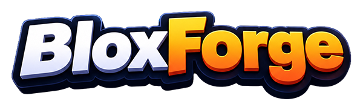
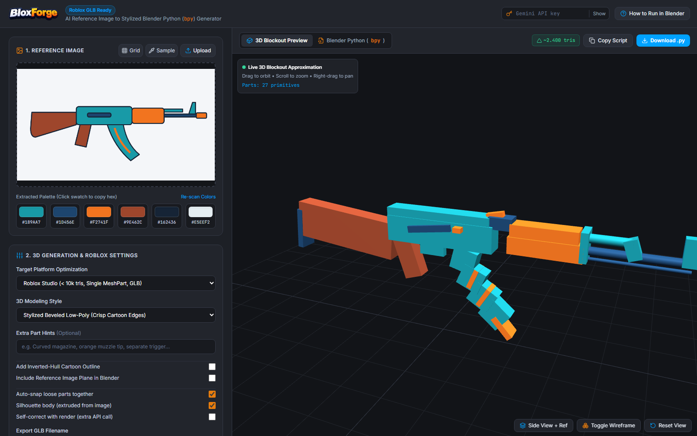
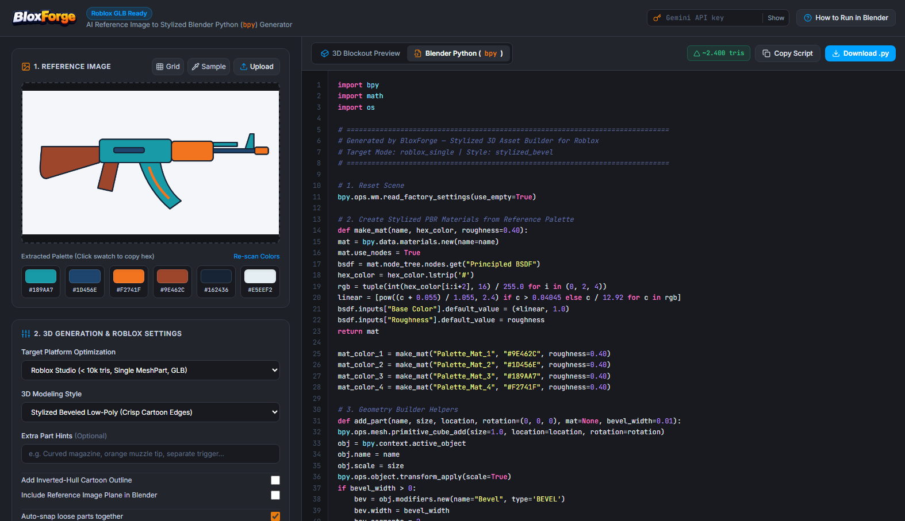

<p align="center">
  
</p>

<p align="center">
  <b>Turn a flat reference image into a Roblox-ready 3D asset.</b><br>
  Gemini reads the picture, BloxForge rebuilds it in 3D, and you leave with a Blender script and a clean GLB.
</p>

<p align="center">
  <a href="https://itssatria.github.io/BloxForge/"></a>
  
  
  
  
  
</p>



---

## What it does

Most "AI makes a 3D model" tools hand you a dense, untextured blob that no Roblox game would ship. BloxForge goes the other way: it keeps assets **low-poly, hard-edged and made of primitives**, which is what actually looks good on Roblox and stays inside a sane triangle budget.

Drop in a picture of an object, a prop or a weapon. The app returns:

- a **live 3D blockout** you can orbit while it works,
- a **ready-to-run Blender Python (`bpy`) script** that rebuilds the model with proper materials,
- a **single-mesh GLB** with one material slot per color, ready to import as a `MeshPart`.

## How the pipeline works

| Step | What happens |
| --- | --- |
| **1. Read** | Gemini Vision labels the reference image as a list of 2D boxes: name, rectangle, color, and whether the part is round or boxy. |
| **2. Unflatten** | Boxes are mapped onto a projection plane and given real depth, so a flat drawing becomes a solid blockout instead of a picture standing upright. |
| **3. Weld** | Loose parts are detected as disconnected components and rigidly snapped onto the main body, so nothing floats off the model. |
| **4. Build** | The image silhouette is extruded into a body shell, the part list is written into a `bpy` script, and the same part list feeds the Three.js preview and the GLB exporter. |

Everything after the vision call is deterministic, so an imperfect read still produces a script you can hand-edit.

## Features

**Input**
- Drag-drop or pick any PNG/JPG reference; a built-in AK-47 preset loads on first visit.
- Palette extraction with click-to-copy hex swatches, plus an eyedropper to sample straight off the image.
- Optional part hints ("curved magazine, orange muzzle tip") to steer the read.

**Geometry**
- Sanitized part specs: bad numbers, colors or sizes can't break the script or the preview.
- Loose-part detection and auto-snap onto the main body.
- Silhouette body extrusion for shapes primitives alone can't describe.
- Inverted-hull cartoon outline option, bevel width control, single-mesh or multi-part output.

**Export**
- `Download .py` for Blender, including the reference-plane option for aligned comparison.
- `.glb` export built in-browser with `GLTFExporter`; one material slot per color for `MeshPart` imports.
- Live triangle counter with a Roblox-friendly target mode under 10k tris.

**Viewport**
- Orbit, zoom, pan, reset; perspective and orthographic side-by-side reference view.
- Wireframe toggle and a proportion grid overlay.

## Quick start

```bash
npm install
npm run dev      # http://localhost:5173
```

Build a static bundle:

```bash
npm run build    # -> dist/
npm run preview  # sanity-check the production bundle
```

Node 18+ is recommended.

### The API key

There is no backend. Each visitor pastes their own [Gemini API key](https://aistudio.google.com/apikey) into the header; it stays in that browser's `localStorage` and is sent directly to Google.

> Never hardcode a key in the source. Anything in a public build is readable by every visitor. If you want a shared key, put a small serverless proxy in front of the API and keep the key server-side.

## From image to Roblox

1. Set **Target Platform Optimization** to `Roblox Studio (< 10k tris, Single MeshPart, GLB)`.
2. Click **Generate Blender Python Script**.
3. **Download .py** and run it in Blender (Scripting > Open > Run Script). The model arrives with materials already applied.
4. Tweak the mesh, then `File > Export > glTF 2.0 (.glb)`.
5. Import the GLB into Roblox Studio and convert it to a `MeshPart`; the imported mesh keeps one material slot per color.

## Project layout

| Path | Purpose |
| --- | --- |
| `index.html` | Page markup, panels and controls. |
| `src/main.js` | App logic: canvas, Gemini calls, script builder, Three.js preview, UI wiring. |
| `src/parts.js` | Pure geometry helpers: sanitize, bounds, loose-part detection, snapping. |
| `src/exporter.js` | In-browser GLB export from the part list. |
| `src/presets.js` | Built-in AK-47 preset parts. |
| `src/style.css` | Tailwind entry plus custom styles. |
| `docs/` | Readme images. |

## Deployment

The repo ships with a GitHub Pages workflow:

- `Settings > Pages > Source` must be set to **GitHub Actions** (already configured for this repo).
- Every push to `main` runs `.github/workflows/deploy.yml`, builds with Vite and publishes `dist/`.
- `vite.config.js` uses `base: './'`, so the bundle works from a project subpath.

Any static host works the same way: build command `npm run build`, output directory `dist`.

## Blender output

The generated script is plain `bpy`: it resets the scene, builds Principled BSDF materials from the extracted palette, creates one object per part with bevel modifiers, and optionally adds an inverted-hull outline and the reference image plane. You can read it top to bottom before running it.

<p align="center">
  
</p>

## Notes

- The vision read is a suggestion, not a measurement; treat the first generation as a blockout.
- Complex organic shapes are out of scope by design. Props, weapons, tools and stylized objects are the sweet spot.
- No license file yet: add one before reusing this code in your own project.
